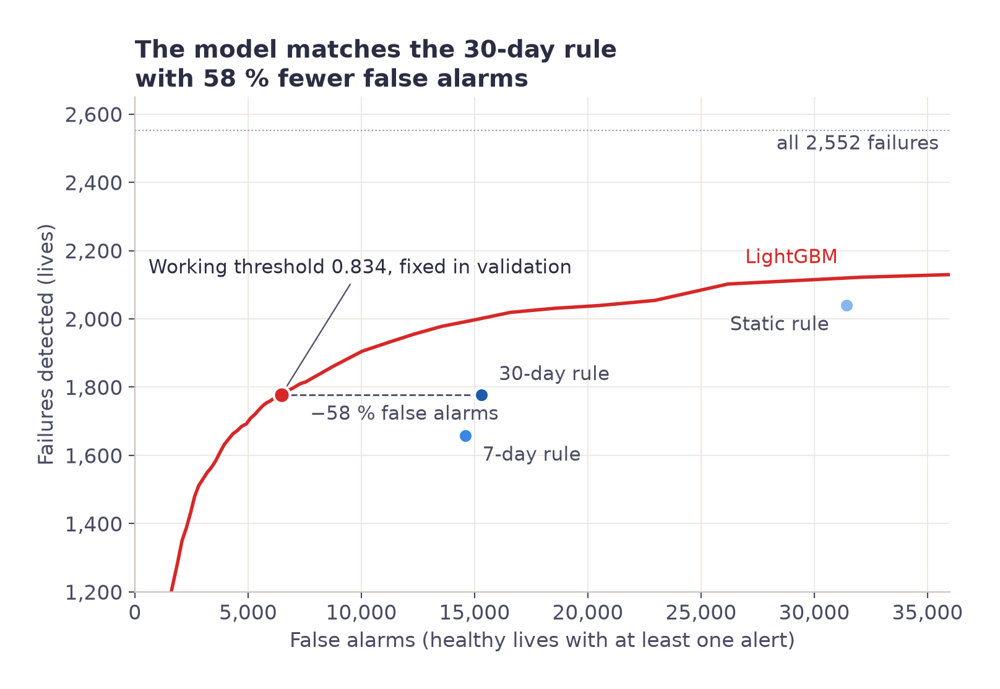
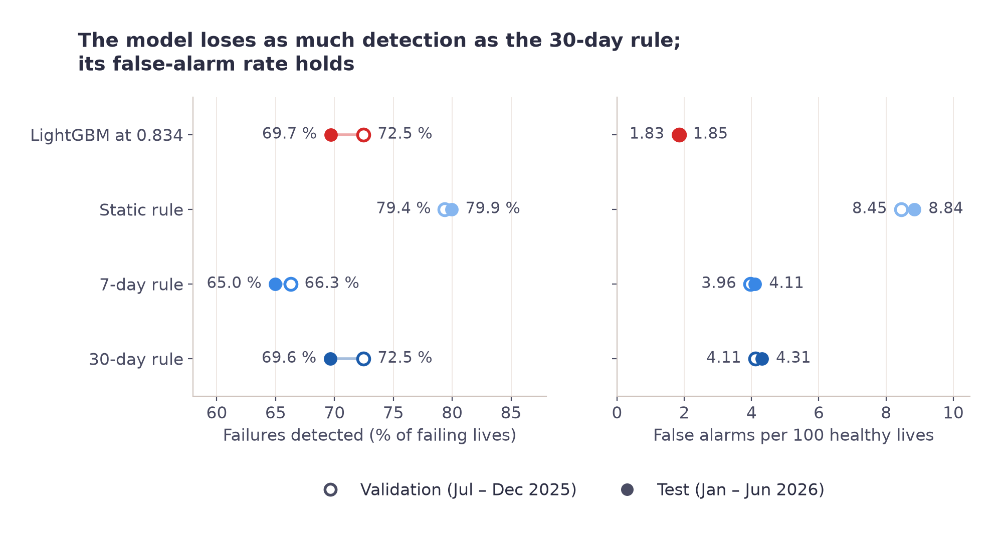
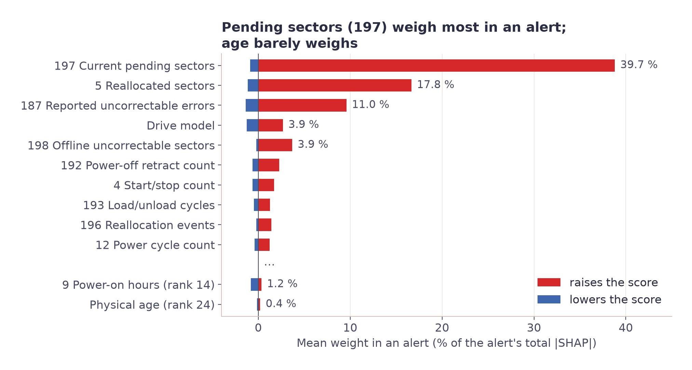
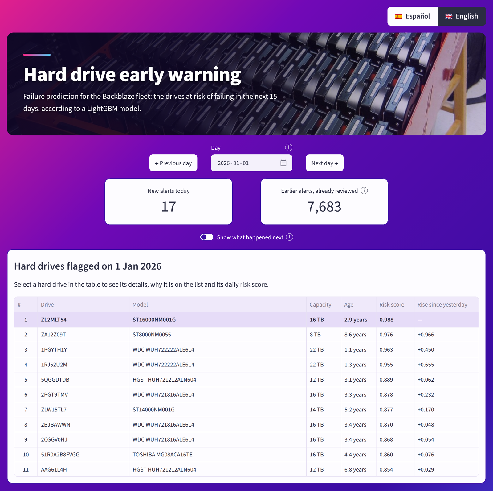
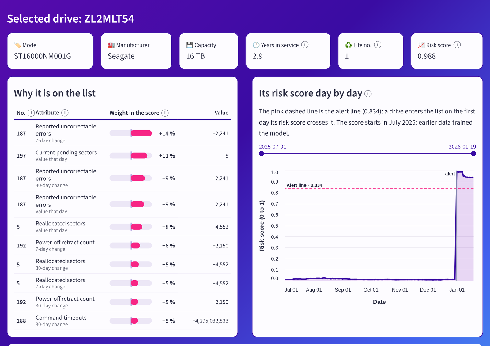

# Predicting hard-drive failures with Backblaze Drive Stats

💽 **[Live dashboard](https://backblaze-hdd-failure-prediction.streamlit.app/)**

Every day, the technician of a data centre has to decide which hard drives to back up or replace before they
fail. This project gives that technician a short daily list. A LightGBM model gives every hard drive a daily
**risk score**, from 0 to 1, of failing in the next 15 days, and the drives that cross a fixed alert line enter
the list, each with an explanation of why. It uses three years of public Backblaze Drive Stats data (330 million
drive-days), processed with DuckDB and Parquet on a single laptop.

On the test period (January – June 2026), which was not looked at until the final evaluation, and with the alert
line fixed beforehand (0.834), the model detects as many failures as the rule of five in its 30-day version, the
S.M.A.R.T. check a technician would use today (1,778 of 2,552 failures against 1,777). It does so with 58 % fewer
false alarms (6,483 against 15,313, among 355,201 drive lives that did not fail).

In the figure, the red curve is the model at every possible alert line, the red dot is the line fixed in
validation and the blue dots are the three versions of the rule of five.



This is version 1 of the project; what comes next is in [Next versions](#next-versions).

## The data and the question

Backblaze, a cloud storage company, publishes one row per drive and day with its model, a failure flag and its
S.M.A.R.T. attributes, the counters each drive keeps about its own health. From July 2023 to June 2026 there are
406,098 hard drives, 330,072,154 drive-days and 13,531 failures. SSDs are left out.

"Will this drive fail?" has no answer without a time limit, so the question is *will this hard drive fail in the
next 15 days?* The horizon, H = 15 days, comes from a rule fixed before looking at the data. Ten days before
failing, 62.8 % of the drives that failed in training already showed a rise in one of five key S.M.A.R.T.
attributes. The rule accepts losing at most a tenth of that signal, so the bar is 0.9 × 62.8 = 56.5 %. At 15 days,
58.2 % still show it, above the bar, and 15 is the largest horizon the rule allows, so H = 15.

Everything runs on a single laptop.

> **Decision**: DuckDB on Parquet files instead of PySpark, with the heavy steps run one quarter per process and
> one day at a time, under a 2 GB memory cap.
>
> **Why**: there is one machine, not a cluster, and PySpark needs Java outside the uv environment. DuckDB runs SQL
> on Parquet files and spills to disk when a query does not fit in memory, and Parquet is stored by column, so each
> step reads only the columns it needs. The memory cap came after one pass over a whole layer ran the machine out
> of memory.
>
> **Discarded**: PySpark.

The data go through three layers of Parquet files: bronze, a faithful copy of the CSV files; silver, with types and
only the hard drives; and gold, which adds the label, 1 when the failure is 0 to 15 days ahead, and 131 variables,
mainly each attribute's value that day and its change over 7 and 30 days.

> **Decision**: an attribute that a manufacturer does not report stays empty, not 0.
>
> **Why**: 0 means "no errors", the value of a healthy drive, while empty means "not measured", and LightGBM handles
> empty values on their own. It matters because two of the five key attributes, 187 and 188, come almost only from
> Seagate drives, so for about two thirds of the fleet they are not measured.
>
> **Discarded**: filling unreported attributes with 0.

> **Decision**: the 266 "failures" of the Toshiba MG08ACA16TEY in the third and fourth quarters of 2025 count as
> drives retired without failure, and their last 15 days get no label.
>
> **Why**: Backblaze explains that it pulled them to update their firmware, not because they broke; in the third
> quarter that drive model "failed" at 16.95 % a year, 9.2 times its usual 1.85 %. Kept as failures, they would be
> misses that never happened. The cost is that about 23 real failures a quarter are lost with them.
>
> **Discarded**: relabelling failure spikes by our own criterion, which would remove the hardest failures and
> flatter the model. A quarter is relabelled only if Backblaze explains that there was no mechanical failure.

The model trains on July 2023 – June 2025, gets its alert line on validation (July – December 2025) and is tested
on January – June 2026.

## Approach

The baseline is the **rule of five**, what a technician checks today without a model: an alert when one of five
S.M.A.R.T. counters of bad sectors and errors (5, 187, 188, 197 and 198) is above 0 (the static rule) or rose over
the last 7 or 30 days.

> **Decision**: evaluate per **drive life** (a drive reinstalled after a failure starts a new one), with only the
> alerts of the evaluated period. A failing life is detected if it gets an alert 0 to 15 days before the failure,
> and a life that does not fail and gets at least one alert is one false alarm.
>
> **Why**: the technician acts once, on the first alert. Counted per drive-day, a healthy drive with stable "bad"
> values would add a new error every day, and a healthy life is watched on a median of 184 days in validation.
>
> **Discarded**: counting false alarms per drive-day.

The model is LightGBM, trained on every positive drive-day and 0.5 % of the negative ones.

> **Decision**: the alert line is 0.834, the risk score at which the model detects the same 1,401 failures as the
> 30-day rule in validation.
>
> **Why**: it does so with 55 % fewer false alarms (6,231 against 13,877), so nothing the technician has today
> gets worse and the list is less than half as long.
>
> **Discarded**: 0.49, the line with the same false alarms as the 30-day rule, which catches 133 more failures for
> 7,646 more false alarms.

> **Decision**: call the model's output a **risk score**, not a probability.
>
> **Why**: the training sample has 1 positive drive-day for every 7.7 negative ones, against 1 for every 2,254 in
> validation, so the scores are inflated: only about 1 in 5.4 lives above 0.834 fails in time. They still rank the
> drives well, which is what the list needs.
>
> **Discarded**: calibrating the score now, which would change no result, only the number shown.

## Results

The table gives the model at the alert line of 0.834 and the 30-day rule in both periods. False alarms are
counted among the lives that did not fail.

| | Validation (Jul – Dec 2025) | Test (Jan – Jun 2026) |
|---|---|---|
| Failures detected by the model | 1,401 of 1,933 (72.5 %) | 1,778 of 2,552 (69.7 %) |
| Failures detected by the 30-day rule | 1,401 of 1,933 (72.5 %) | 1,777 of 2,552 (69.6 %) |
| False alarms of the model | 6,231 of 337,528 | 6,483 of 355,201 |
| False alarms of the 30-day rule | 13,877 of 337,528 | 15,313 of 355,201 |

In test, 1,627 of the 1,778 detected failures had at least 2 days of margin. With the same false alarms as each
rule, the model also beats the static rule (2,121 failures against 2,040) and the 7-day rule (1,992 against 1,658).

The model detects fewer failures in test than in validation. The figure compares the two periods: the failures
detected on the left and the false alarms per 100 healthy lives on the right.



The 30-day rule, which learned nothing from the data, drops just as much, and the model's false alarms hold: the
failures changed, not the model. About half of the drop comes from more failures whose signal is above 0 but
flat, and most of the rest from failures with no signal at all, many of them from one drive model, the Seagate
ST24000NM002H. [Notebook 04](notebooks/04_results.ipynb) has the full analysis.

The next figure gives each variable's average weight in the 7,683 first alerts of validation, from SHAP: red raises
the risk score and blue lowers it.



The model watches the same counters as the rule of five, above all 197 (pending sectors), but it uses how high
they are and how fast they change. Age barely weighs.

An alert rarely means that the failure is close. Of the 6,429 first alerts of validation (leaving out 1 July, the
start-up day), 308 (4.8 %) failed within 15 days and 1,734 (27.0 %) failed later, a median of 117 days after the
alert. The other 4,189 (65.2 %) were still running in June 2026, and 87.3 % of them spent most of the days after
the alert back below the line.

> **Decision**: each drive life enters the list once, on the first day it crosses the line.
>
> **Why**: a drive already on the list would have been checked.
>
> **Discarded**, for a later version: alerting again when a reviewed drive gets worse. The cost is that a drive
> flagged months before does not come back when it is really about to fail, although the evaluation counts it as
> detected if its score is above the line in its last 15 days.

## The app

For a day between 1 July 2025 and 15 June 2026, as if it were today, the app lists the drives that cross the alert
line for the first time, ordered by risk score. For each drive it shows its details, why it entered the list
(SHAP) and its risk score day by day, and a switch, *Show what happened next*, reveals whether it really failed.
It opens on 1 January 2026 and is in English and Spanish.

The first screenshot shows the list of one day, and the second shows one drive.





The app lives in [`streamlit_dashboard_github/`](streamlit_dashboard_github/README.md), with its own data and a
README that explains how to read it and run it on your computer.

## The notebooks

The four notebooks tell the full story, with every decision and its reason. They are saved with their outputs.

| Notebook | What it covers |
|---|---|
| [01 · Data and context](notebooks/01_data_and_context.ipynb) | Backblaze and the question, the S.M.A.R.T. attributes, the tools, and the bronze and silver layers |
| [02 · Exploration and gold layer](notebooks/02_exploration_and_gold_layer.ipynb) | Which attributes each manufacturer reports, why H = 15, the MG08 episode, the label and the variables |
| [03 · Baselines and model](notebooks/03_baselines_and_model.ipynb) | Evaluation per drive life, the rule of five, LightGBM, the comparisons and the alert line |
| [04 · Results](notebooks/04_results.ipynb) | The test period, why detection drops there, what pushes the alerts (SHAP) and the limitations |

## How to reproduce it

You need [uv](https://docs.astral.sh/uv/) and about 40 GB of free disk. `uv sync` installs Python 3.14 and the
exact library versions of `uv.lock`, and `uv run pytest` runs the tests. The data are not in the repository: the
first step downloads them from Backblaze.

```text
.
├── src/backblaze_hdd_failure_prediction/   the pipeline, one module per step, and the notebooks' code
├── notebooks/                              the four notebooks
├── output_figures/                         their figures and the app screenshots
├── streamlit_dashboard_github/             the app, with its own data
└── tests/
```

Each step runs from the project folder as `uv run python -m backblaze_hdd_failure_prediction.<step>`, in this
order. Heavy steps work one day at a time, and we ran them under a 2 GB memory cap.

| Step | What it writes |
|---|---|
| `ingest 2023Q3 2026Q2` | Bronze: the CSV files as Parquet |
| `drives`, `inventory` | One row per drive, and drives and failures per model and quarter |
| `clean 2023Q3 2026Q2` | Silver |
| `exploration coverage`, `signal`, `episodes` | The exploration tables |
| `gold lookups`, `gold build 2023Q3 2026Q2` | Gold |
| `evaluation lives <quarter>` (2025Q3 to 2026Q2), `evaluation summary` | The rules, per life |
| `train sample <quarter>` (2023Q3 to 2025Q4), `train search` | The training sample and the model |
| `predict <quarter>` (2025Q3 to 2026Q2), `evaluation summary` | The risk scores, and the model against the rules |
| `explain <quarter>` (2025Q3 to 2026Q2), `dashboard`, `evaluation failures` | SHAP of the first alerts, the app's tables and the failures by signal |

## Next versions

- **v2, location:** whether failure rates change with where a drive sits (data centre, pod and slot) beyond its
  drive model, and the model with and without location.
- **v3, model comparison:** LightGBM against XGBoost and CatBoost with the same tuning budget and bootstrap
  intervals, logistic regression and drive model plus age as baselines, and results by group of drives.
- **A possible v4:** TabM, a calibrated score, alerting again when a reviewed drive gets worse, and fleet-level
  questions such as how many drives will fail.

## Credits and licence

Data: [Backblaze Drive Stats](https://www.backblaze.com/cloud-storage/resources/hard-drive-test-data), published
by Backblaze. The app's header photo is "StoragePod" by ChrisDag, under CC BY 2.0, cropped (see
[`streamlit_dashboard_github/static/CREDITS.md`](streamlit_dashboard_github/static/CREDITS.md)). The code is under
the MIT licence (see [`LICENSE`](LICENSE)).
